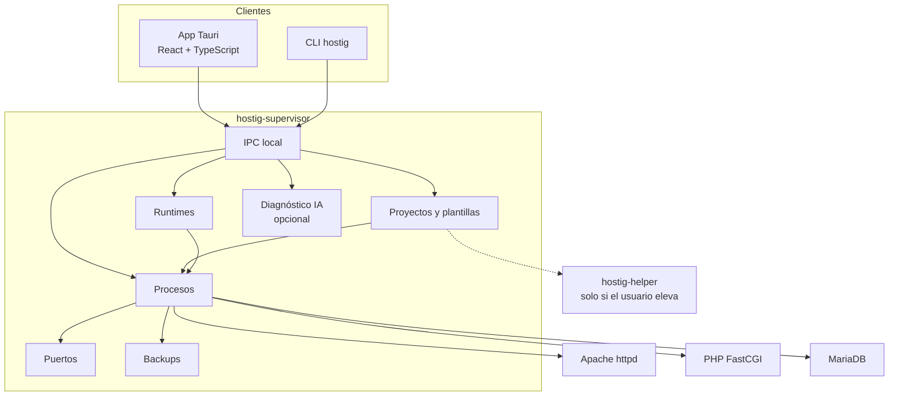
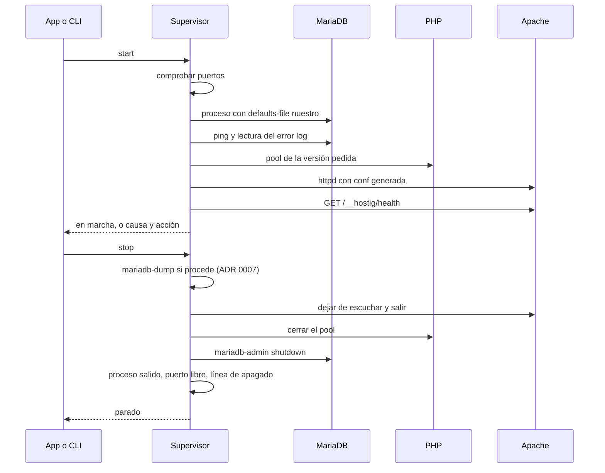

# Arquitectura de Hostig

Hostig es una alternativa open source y gratuita a XAMPP, para Windows, macOS y Linux. El núcleo está en Rust, dentro de un proceso supervisor. La interfaz es una app Tauri v2 con React, TypeScript y Tailwind. El identificador provisional del bundle es `dev.hostig.app`, pendiente de confirmar el dominio. Una CLI habla con el mismo supervisor.

Prioridades, en este orden: estabilidad, eficiencia, experiencia visual. El aspecto se trabaja cuando arrancar y parar ya es fiable. Este documento no contiene código de producto. Las decisiones están en [adr/](adr/README.md). El comportamiento que se quiere evitar está descrito en [research/xampp-analisis.md](research/xampp-analisis.md).

## Qué problema resuelve la forma del sistema

XAMPP junta el panel, scripts de parada y el estado real de los procesos. En la instalación analizada, parar MariaDB no pasa por el servidor, los archivos PID quedan atrasados y el registro de InnoDB entra en recuperación sin una línea de apagado. Hostig separa esas responsabilidades para que cada una tenga un dueño y una prueba.

Reglas que salen de ahí:

- La UI no mata procesos ni edita `my.ini` o `httpd.conf`. Pide una operación al supervisor.
- El supervisor es el único que crea y destruye servidores.
- La configuración de Apache y PHP se genera desde plantillas.
- Los binarios de terceros y los datos viven en la carpeta del usuario, no en rutas de sistema, y el producto no modifica el `PATH`.
- Un error de log lleva causa y acción sugerida.

## Módulos



| Módulo | Responsabilidad | No hace |
|---|---|---|
| App Tauri | Estado, acciones, texto de errores, ajustes | No arranca `httpd` ni escribe hosts |
| CLI | Las mismas operaciones, para scripts y pruebas | No tiene estado propio |
| IPC | Autenticar al cliente y entregar comandos | No contiene la política de apagado |
| Runtimes | Descargar, verificar, guardar versiones | No decide qué proyecto usa cuál |
| Proyectos | Manifiesto, plantillas, vhost, pool PHP, esquema | No edita conf a mano |
| Procesos | Arranque, health check, backoff, apagado | No elige el puerto alternativo |
| Puertos | Decir quién escucha y proponer un puerto libre | No mata al ocupante |
| Backups | Volcado antes de parar o de cambiar versión | No sube copias a ningún sitio |
| Diagnóstico | Explicar un log si hay proveedor | No participa en arrancar o parar |
| Helper | Hosts, confianza de la CA, reenvío 80/443 | No abre un shell |

El detalle de cada límite está en el ADR correspondiente.

## Procesos



Cerrar la ventana no dispara `stop`. El supervisor sigue. Pararlo es un comando, y ese comando recorre el apagado ordenado.

## Dónde se guarda cada cosa

| Sistema | Carpeta de datos |
|---|---|
| Windows | `%LOCALAPPDATA%\Hostig` |
| macOS | `~/Library/Application Support/Hostig` |
| Linux | `$XDG_DATA_HOME/hostig` o `~/.local/share/hostig` |

Otra carpeta solo si `HOSTIG_DATA_DIR` apunta a ella.

```text
{datos}/
  auth.token                 # 0600, handshake del IPC
  runtimes/{componente}/{versión}-{os}-{arch}/
  instances/{id}/            # datadir, logs y conf de esa MariaDB
  projects/{slug}/project.toml
  projects/{slug}/generated/ # solo salida de plantillas
  backups/{instancia}/{esquema}/
  ca/                        # CA local, claves 0600
```

El código del sitio queda en la carpeta que elija la persona. El socket del supervisor no vive en esta raíz en Linux: va a `$XDG_RUNTIME_DIR/hostig/supervisor.sock`. En macOS y Windows la ruta está en el [ADR 0001](adr/0001-supervisor-ipc.md).

## Decisiones

| # | Tema | Estado |
|---|---|---|
| [0001](adr/0001-supervisor-ipc.md) | Supervisor aparte. Socket Unix o named pipe. JSON-RPC con testigo y peer check | Aceptado |
| [0002](adr/0002-gestor-de-runtimes.md) | Catálogo con SHA-256. Carpeta del usuario. Fuentes por fases, static-php-cli evaluado, DLL de Visual C++ junto al runtime | Aceptado |
| [0003](adr/0003-supervision-de-procesos.md) | Health checks, backoff, `mariadb-admin shutdown`, LSN futuro = fallo | Aceptado |
| [0004](adr/0004-gestion-de-puertos.md) | Dueño del puerto antes de arrancar. Alternativa solo con confirmación | Aceptado |
| [0005](adr/0005-proyectos-y-plantillas.md) | FastCGI, MariaDB compartida por versión mayor, pool de N `php-cgi` en Windows | Aceptado |
| [0006](adr/0006-privilegios.md) | Helper mínimo. El MVP no lo necesita | Aceptado |
| [0007](adr/0007-backups.md) | Volcado solo con escrituras o copia de más de 24 h. Si hace falta y falla, no se para. Nunca en el apagado del sistema | Aceptado |
| [0008](adr/0008-diagnostico-ia.md) | Ollama o API compatible con OpenAI. Todo funciona sin IA | Aceptado |
| [0009](adr/0009-licencia.md) | Apache-2.0. Sin binarios de terceros en el instalador | Aceptado |
| [0010](adr/0010-distribucion.md) | CI en los tres sistemas desde el principio. Firma de Windows primero. Runtimes en un pipeline aparte | Aceptado |
| [0011](adr/0011-apagado-del-sistema.md) | Apagado, cierre de sesión y suspensión. Parada rápida sin volcado. Sin job que mate a MariaDB | Aceptado |
| [0012](adr/0012-preflight-mariadb.md) | Preflight del datadir MariaDB, cuarentena y plazos de arranque (cuelgue vs recuperación) | Aceptado |


### Fuentes de los runtimes

Investigadas en octubre de 2026. Los builds de CI desde el fuente oficial están aceptados por fases. El detalle de static-php-cli y de las DLL de Visual C++ está en el [ADR 0002](adr/0002-gestor-de-runtimes.md).

| | Windows | Linux | macOS |
|---|---|---|---|
| Apache | ZIP de Apache Lounge, con las DLL de Visual C++ redistribuibles en la misma carpeta. Checksum fijado | Fase 1b: fuente ASF (SHA-256 y PGP) compilada en CI a un prefijo reubicable | Fase 1c: igual que Linux |
| PHP | ZIP NTS x64 oficial de windows.php.net. Pool de N `php-cgi` | Fase 1b: static-php-cli fijado, con la barra de verificación del ADR 0002, y `php-fpm`. Compilación manual solo si esa herramienta no puede emitirlo | Fase 1c: igual que Linux |
| MariaDB | ZIP oficial de mariadb.org, no el MSI | Tarball genérico oficial, siempre con `--defaults-file` nuestro | Fase 1c: fuente oficial verificada, compilada en CI a un prefijo reubicable. PKG y Homebrew no se usan |

FastCGI es deliberado: permite una versión de PHP por proyecto sin cargar `mod_php` dentro de Apache. En Windows el build es el NTS oficial, en un pool de N procesos `php-cgi`, no el módulo TS atado al Visual C++ de Apache Lounge.

## Estructura del repositorio

Todavía no hay código. Esta es la forma prevista, para que los módulos no se mezclen cuando se escriba.

```text
hostig/
  apps/
    desktop/                 # Tauri v2, React, TypeScript, Tailwind
    cli/                     # cliente delgado del supervisor
  crates/
    supervisor/              # binario hostig-supervisor, compone los módulos
    ipc/                     # framing, auth, tipos de comandos
    runtimes/
    processes/
    ports/
    projects/
    backup/
    diagnose/                # se puede compilar sin proveedor
  helpers/
    privileged/              # hostig-helper, fase 3
  templates/
    apache/
    php/
  catalog/
    runtimes.toml            # URL, hash, licencia, glibc o VC++
  docs/
    ARCHITECTURE.md
    adr/
    research/
  .github/
    workflows/               # app en tags v*, runtimes solo si cambia el catálogo
```

La app de escritorio depende de `ipc` para hablar con el supervisor. No depende de `processes` ni de `runtimes`. El supervisor depende de esos crates y no de Tauri.

## Roadmap

### Fase 0 — Cimientos

IPC, lock de una sola instancia, log estructurado, carpeta de datos. Sin servidores todavía. Prueba: la CLI obtiene `status` del supervisor y un segundo arranque no crea otro proceso.

El CI de la aplicación compila y ejecuta los tests en Windows, Linux y macOS desde esta fase. Eso no adelanta el stack funcional de Linux ni de macOS.

### Fase 1 — MVP, solo Windows x64

Arrancar y parar Apache, PHP y MariaDB de forma estable en Windows x64.

Incluye:

- Una versión fijada de cada componente, descargada a la carpeta de datos y comprobada con el hash del catálogo. En Windows son los ZIP de Apache Lounge, windows.php.net y mariadb.org.
- Un Apache, un pool de N `php-cgi` y una MariaDB, con la configuración salida de plantillas.
- Health checks y la regla del log de InnoDB.
- `mariadb-admin shutdown`, espera a que el proceso salga, y comprobación de que el puerto quedó libre.
- Si el puerto está ocupado: PID, nombre si el sistema lo da, y un puerto alternativo. No se mata al ocupante.
- CLI y una ventana mínima: estado, arrancar, parar, última causa.
- Puertos altos. Sin `.test`, sin SSL, sin helper, sin IA, sin backup de proyectos con nombre. El `stop` de la única base sigue el [ADR 0007](adr/0007-backups.md): vuelca si no hay copia de menos de 24 horas o si hubo escrituras desde la última copia. En una carpeta de datos vacía, el primer `stop` sí vuelca.
- Las DLL de Visual C++ redistribuibles, dentro de la carpeta del runtime. Sin administrador.

Verificaciones de esta fase, además de la definición de hecho:

- Qué hacen `mariadbd.exe` y `httpd.exe` ante `CTRL_SHUTDOWN_EVENT` y `CTRL_LOGOFF_EVENT`, y el margen real tras `WM_ENDSESSION` ([ADR 0011](adr/0011-apagado-del-sistema.md)).
- El reciclado de `php-cgi` por `PHP_FCGI_MAX_REQUESTS` sale con código 0, y `mod_proxy_balancer` con `retry=1` no deja el miembro caído más de un segundo ([ADR 0005](adr/0005-proyectos-y-plantillas.md)).

No incluye el diseño visual definitivo. La ventana tiene que entenderse; la prioridad visual llega en la fase 5.

### Fase 1b — Linux

La misma definición de hecho que la fase 1, en Linux x64. Apache y PHP salen del CI (PHP con static-php-cli si cumple la barra del ADR 0002). MariaDB es el tarball genérico oficial.

### Fase 1c — macOS

La misma definición de hecho, en macOS. Apache, PHP y MariaDB salen del CI a partir del fuente oficial verificado. La firma de macOS llega con la distribución pública de esta fase, no antes.

### Fase 2 — Proyectos

Manifiesto, varias versiones de PHP en disco, un pool por proyecto, un esquema por proyecto, vhosts generados, backup con retención por esquema.

También:

- Importar desde XAMPP. Se copian los archivos de `htdocs` que la persona indique. Las bases se vuelcan conectando al MariaDB de XAMPP que esté en marcha. No se copia su `datadir`: el análisis vio ahí el redo por detrás del tablespace.
- Adminer, opcional, como gestor de base de datos. Se descarga con el catálogo (hash y licencia Apache-2.0) y no entra en el instalador de la app.
- Mailpit, opcional, como captura de correo. Se descarga igual (licencia MIT) y no entra en el instalador.

### Fase 3 — Nombres, SSL y privilegios

Helper, bloque del archivo hosts, CA local, reenvío de 80/443, y el modo `.localhost` cuando el usuario no eleva.

### Fase 4 — Distribución

Firma del updater y release pública. El CI de los tres sistemas ya existe desde la fase 0; aquí se publica. La firma de Windows (Azure Trusted Signing, con el límite de identidad del ADR 0010) es previa a la release pública de Windows. La de macOS espera a la fase 1c. Los prefijos de runtime de Linux y macOS salen en `runtimes.yml` con esas fases, no dentro del instalador.

### Fase 5 — Diagnóstico y experiencia visual

Ollama o clave del usuario, y el trabajo de interfaz. Nada de esta fase bloquea el uso del stack.

## Definición de hecho del MVP

La misma lista cierra la fase 1 en Windows x64, la fase 1b en Linux y la fase 1c en macOS. En una carpeta de datos vacía, en el sistema de esa fase:

1. `hostig start` descarga lo que falte, verifica el hash, arranca Apache, el pool de PHP y MariaDB y responde cuando el health check HTTP pasa por Apache y PHP y `mariadb-admin ping` responde.
2. `hostig stop` vuelca la base si no hay una copia de menos de 24 horas o si hubo escrituras desde la última, apaga MariaDB con su comando de shutdown, para PHP y Apache, y termina con el puerto libre, los procesos desaparecidos y una línea de apagado en el log de MariaDB. En esta prueba de carpeta vacía el volcado sí ocurre.
3. Con el puerto ya ocupado por otro programa, `start` no lanza servidores. La respuesta nombra al ocupante y propone otro puerto.
4. Cerrar la ventana deja los servidores en marcha. `stop` desde la CLI los apaga igual.
5. Ningún paso pide administrador, no cambia el `PATH` y no escribe fuera de la carpeta de datos. En Windows las DLL de Visual C++ van dentro de la carpeta del runtime.

6. En Windows, la prueba se ejecuta en Windows Sandbox: una máquina limpia, sin el redistribuible de Visual C++ instalado. `httpd.exe`, `php-cgi.exe` y `mariadbd.exe` arrancan desde la carpeta del runtime.

Sin esa prueba, la fase de ese sistema no está hecha. El CI puede estar en verde en los tres sistemas antes de que Linux o macOS cumplan esta lista.

## Riesgos

| Riesgo | Por qué importa | Mitigación ya decidida |
|---|---|---|
| Apache y PHP no tienen binario oficial reubicable en macOS ni en Linux. MariaDB tampoco en macOS | La fase 1b y la 1c no pueden usar un ZIP upstream | Builds de CI desde el tarball oficial, ya aceptados en esas fases. PHP pasa antes por static-php-cli. Windows sigue con Apache Lounge, windows.php.net y el ZIP de MariaDB |
| Apache Lounge no es la ASF | Un build de terceros puede ir retrasado o cambiar de compilador (ahora VS18) | Hash fijado en git. El catálogo se actualiza con revisión, no al vuelo |
| Runtime de Visual C++ en Windows | Sin esas DLL, httpd no arranca, y el instalador central pide administrador | Las DLL redistribuibles van en la carpeta del runtime. Microsoft lo permite y no lo recomienda, porque Windows Update no las parchea. El catálogo las sustituye al subir de versión |
| glibc del tarball de MariaDB | Distros antiguas no cargan el binario | El catálogo declara el mínimo y el error lo repite |
| Cierre de Apache en Windows | El ZIP de consola puede querer `httpd -k shutdown` o una señal al grupo de proceso | El MVP lo decide con un test y deja escrita la vía que funcione. Ninguna de las dos es `taskkill` por nombre |
| Dump largo bloquea `stop` | Es el coste de no parar a ciegas | Override explícito y auditado, fuera del botón principal |
| AppImage y FUSE | En algunos Linux no arranca | Documentar `APPIMAGE_EXTRACT_AND_RUN`. Un `.deb` queda fuera del MVP |
| SmartScreen y Gatekeeper | Sin certificado, el primer arranque asusta | Windows se firma primero. Azure Trusted Signing no cubre a una persona física fuera de Estados Unidos y Canadá. macOS espera a su fase |
| Clave del updater perdida | Los clientes instalados no pueden actualizar | Copia fuera de GitHub el día que se genere. El ADR no sustituye esa copia |
| Dos instalaciones en la misma máquina | Ya pasó con XAMPP 7.4 y 8.2 | Identidad por ruta y PID registrado, nunca por nombre de imagen |
| IA enviando logs a un tercero | Rutas y consultas pueden colarse en un error | Tope de 32 KiB, confirmación si el proveedor no es loopback, clave en el llavero |

## Decisiones confirmadas

1. **Binarios compilados por nosotros.** Aceptados, por fases. Windows en la fase 1 usa los ZIP upstream. Linux (1b) y macOS (1c) publican prefijos de CI desde el fuente oficial verificado, en una release distinta del instalador. PHP en Linux y macOS prefiere static-php-cli con la barra del [ADR 0002](adr/0002-gestor-de-runtimes.md). MariaDB en Linux sigue siendo el bintar oficial. El fuente exacto de MariaDB viaja al lado cuando el binario lo compilamos nosotros.
2. **Licencia.** Apache-2.0. Están `LICENSE` y `NOTICE`.
3. **MariaDB compartida.** Una instancia por versión mayor y un esquema por proyecto.
4. **Backup.** Si el volcado hace falta y falla, no se para. Sigue el override explícito `stop --without-backup`. El volcado solo se hace si hubo escrituras desde la última copia o si esa copia tiene más de 24 horas, configurable. Durante el apagado del sistema no se vuelca.
5. **Firma.** Primero Windows, evaluando Azure Trusted Signing. macOS cuando llegue su fase.

La documentación de Microsoft limita la confianza pública de Azure Trusted Signing, para una persona física, a Estados Unidos y Canadá. Si quien publica no entra en ese caso, el respaldo es un certificado Authenticode OV. El detalle está en el [ADR 0010](adr/0010-distribucion.md).
